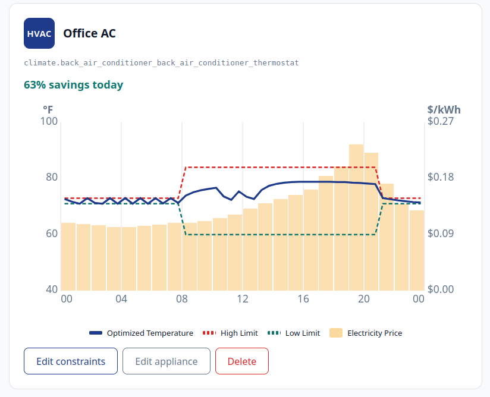

# Hungry Machines — Home Assistant Integration

Outsmart your electric bill - Hungry Machines Energy provides an energy management system that shifts HVAC, EV charging, home batteries, and other electric loads to cheaper hours for homes and buildings with solar power or variable electricity rates. It is designed to work within the comfort and charge limits you set.

This package adds the Hungry Machines control surface to Home Assistant: a sidebar panel for managing schedules and constraints, plus two Lovelace cards for at-a-glance status. Sign in with the same account you create at [hungrymachines.io](https://hungrymachines.io), and your dashboard shows the schedules generated each night.

Learn more at **[hungrymachines.io](https://hungrymachines.io)**.

See how it works and experience the benefits in the [online game](https://hungrymachines.io/feed-your-hungry-machines/).

Questions: [info@hungrymachines.io](mailto:info@hungrymachines.io).




---

## What you get

- **`hungry-machines-panel`** — full-page sidebar entry. Sign in, then **add the appliances you want optimized** (one or more HVACs, plus an EV charger, home battery, water heater, hot tub, pool pump, home robot, or solar array, and a dehumidifier if you want its readings recorded), map each one to its Home Assistant entities, edit the comfort and charge constraints the optimizer respects, choose your pricing, and review a diagnostics view that flags sensor and command problems.
- **`hm-thermostat-card`** — Lovelace card for one HVAC: the room temperature now, what the thermostat is set to, today's estimated savings, the timed-pause buttons, and the optimization chart (your comfort limits and the planned setpoints over the day's prices). Pin it to one HVAC with `appliance_id` when you run more than one.
- **`hm-savings-card`** — Lovelace card that lists each appliance with today's estimated savings and when it is next scheduled to run, plus your home's power draw if you name a sensor. Scope it to a single appliance with `appliance_id`.

All three share one sign-in. Sign in once via the panel and the cards activate everywhere on your dashboard — your token persists in your browser's localStorage. Both cards say so when an HVAC's sensor data looks stale, stuck or missing, and when a unit is paused, has an idle day or has no plan yet. They reload the plan about every five minutes while the dashboard is open, and each links back to the panel.

## How it works

1. You register your appliances and set your preferences in the panel inside Home Assistant. Each HVAC is mapped to its own climate entity (and optional indoor-temperature, humidity, and power sensors); EV chargers, batteries, water heaters, hot tubs, pool pumps, and robots are mapped to their own entities. Solar has no control entity — nothing to switch — but you can point it at a production sensor, and the forecast then learns from your array's real output instead of its nameplate rating.
2. Throughout the day, your Home Assistant captures readings from each appliance (HVAC: indoor temperature, HVAC state and mode, fan, target setpoint, humidity, power) and pushes them to the Hungry Machines Optimization API. If you mapped an indoor-temperature sensor to an HVAC, that sensor is the temperature Hungry Machines models and plans around; without one it uses the thermostat's own reading. The optimizer uses this stream to fit a **per-HVAC thermal model**. Until a model is fitted, plans use default rates and are less exact. To learn how a unit responds, Hungry Machines also schedules a **warm-up test** between 09:00 and 15:00 on a suitable day: a forecast high of 78 °F or more for a cooling test, 55 °F or less for a heating one. A unit can get up to three of these in its first weeks. The setpoints in a test come from inside your comfort range, though on a cooling test the room can drift past it for part of the day. The panel shows a banner while a test is scheduled or running, with a **Skip** option when one is available, and each HVAC card has a **Run warm-up** button to schedule one yourself.
3. Each night, Hungry Machines resolves a 24-hour weather forecast and your rates, then plans each appliance to lower cost within your comfort and charge limits. When the weather or your equipment puts a limit out of reach, it uses the plan that comes closest.
4. Your Home Assistant pulls the resulting schedule and, on every 30-minute boundary, applies it to each appliance. For HVAC that means setpoint, mode, and fan; for an EV charger, battery, water heater, or pool pump it switches the device on or off; for a hot tub it moves the tub's setpoint and does not switch the tub off; a robot is only sent back to its dock. The plan sets a target for the room your sensor sits in, not for the thermostat's dial. Between those boundaries a check runs about every five minutes: when the room reads more than half a degree off its target, the setpoint moves one degree toward closing the gap, at most once every ten minutes, until the room lands where the plan asked. These commands are designed to keep the room inside your comfort range. The range applies to the room, so the number on the thermostat's dial can sit outside it when the thermostat reads differently from your room sensor, and your thermostat's own limits and the freeze floor take priority. The comfort check is the backstop at the edges. The panel and cards in this package show what's running, what's coming next, and how much you save.

Savings figures are estimates until a metered baseline exists: each one is the cost the model predicts a naive thermostat would have run up, minus the plan Hungry Machines chose, both priced on the curve that plan was built against.

The optimization itself (per-HVAC thermal models, HVAC scheduling, EV/battery load-shifting, water-heater, hot-tub and pool-pump control, robot dock charging, solar coupling) lives in the backend. You can visit the [online game](https://hungrymachines.io/feed-your-hungry-machines/) to experience how it works. This package is the user-facing window into it.

## Requirements

- Home Assistant with [HACS](https://hacs.xyz/docs/setup/download) installed.
- A Hungry Machines account — sign up at [hungrymachines.io](https://hungrymachines.io).
- For each HVAC you want optimized, a `climate.*` entity in Home Assistant. A power sensor, a dedicated indoor-temperature sensor, and a humidity sensor are optional but improve the model (you map all of these per-appliance when you add it in the panel). A mapped indoor-temperature sensor becomes the room Hungry Machines optimizes for, so put it where you actually sit. A `weather.*` entity is optional too; pick it in the panel's **Settings** tab to feed the optimizer your local forecast (without one, Hungry Machines uses a forecast for your ZIP code).

---

## Install

No `configuration.yaml` editing required. Five steps, all from the Home Assistant UI.

### Step 1 — Create your Hungry Machines account

Go to **[hungrymachines.io](https://hungrymachines.io)** and sign up. Confirm your email when the verification message arrives. The email and password you set there are what you'll use to sign in inside Home Assistant.

### Step 2 — Add the integration to HACS

1. In Home Assistant, open **HACS → ⋮ (top right) → Custom repositories**.
2. Add `https://github.com/hungrymachines/energy-dashboard` with **Type: Integration**.
3. Search for **Hungry Machines** in HACS and click **Download**.
4. Restart Home Assistant when HACS prompts you.

### Step 3 — Add the integration

1. Open **Settings → Devices & Services → Add Integration**.
2. Search for **Hungry Machines** and click it.
3. Enter your **hungrymachines.io email and password** (the same credentials you use on the website and inside the panel) and click **Submit**. That's the only thing the config flow asks for — you pick your appliances and their entities later, in the panel (Step 4).

A **Hungry Machines** entry now appears in your sidebar, and the two Lovelace cards become available in the dashboard card picker. The integration also begins its background tasks: it captures readings from each registered appliance (buffered and pushed periodically, so the optimizer math can learn how your home responds), once a day it pushes your weather forecast, and each morning it fetches today's optimized schedules and applies them to the appliances.

### Step 4 — Sign in and add your appliances

Click the **Hungry Machines** entry in the sidebar and enter the same hungrymachines.io email and password to load your dashboard. The first time in, the dashboard is empty — use **Add appliance** to register each device you want optimized:

- Pick a type: HVAC, EV charger, home battery, water heater, hot tub, pool pump, home robot, solar, or dehumidifier. If the form recognizes a device you already have, it offers it here, and the entity pickers list likely matches under **Suggested**.
- For HVAC, choose the `climate.*` entity it controls and, optionally, dedicated indoor-temperature / humidity / power sensors. With the optimization mode on Auto, Hungry Machines switches the thermostat between heat and cool for you. On Heating only or Cooling only, keep the thermostat in the same mode, or its setting wins and the log records an error (see [Thermostat modes](#thermostat-modes)). The indoor-temperature sensor is the one Hungry Machines models and plans around — leave it empty to use the thermostat's own reading. Add a card per HVAC if you have more than one — each gets its own thermal model and schedule.
- For an EV charger or battery, choose the switch and any state-of-charge sensor. For a water heater, choose its `switch.*` or `climate.*` entity and, optionally, a tank-temperature sensor.
- For a hot tub, choose its `climate.*` or `water_heater.*` entity and enter the volume and heater wattage. For a pool pump, choose its `switch.*` entity and enter the pump's wattage.
- For a home robot, choose its `vacuum.*` or `lawn_mower.*` entity and, optionally, a battery sensor, then enter its battery capacity and dock charge rate.
- For a dehumidifier, choose its `humidifier.*` entity and a room temperature sensor. It is recorded, not scheduled.
- For solar, enter your system size, tilt, and azimuth, and optionally pick a **production sensor** — a `sensor.*` reporting your inverter's or plug's instantaneous output in W or kW (not an energy `kWh` sensor). Solar has no switch to control; the sensor is what lets Hungry Machines learn your array's real output and shading instead of estimating from the nameplate rating.

Each appliance card then shows today's optimized schedule, an **Edit constraints** button, and a per-appliance pause toggle. HVAC cards also carry **Pause 2 h**, **Pause 4 h** and **Pause 6 h** buttons, which hand that one unit to you for a while and let the plan take it back when the time is up (see [Pausing a unit](#pausing-a-unit)). You can edit or delete an appliance at any time.

### Step 5 — Add the cards (optional)

The panel is the primary surface; the cards are extras for your existing dashboards. In any Lovelace dashboard, click **Add card → Search "Hungry Machines"**. Both cards work with no options:

```yaml
type: custom:hm-thermostat-card
# Optional: pick a specific HVAC when you have more than one registered.
# With exactly one HVAC the card finds it and this can be omitted.
# appliance_id: 11111111-2222-3333-4444-555555555555
# Optional. The room temperature comes from the indoor sensor you mapped
# to the HVAC in the panel, or the thermostat's own reading. Name a
# different sensor here, and an outdoor one to show alongside it.
# entities:
#   indoor_temp: sensor.living_room_temp
#   outdoor_temp: sensor.outside_temp
```

```yaml
type: custom:hm-savings-card
# Optional: show one appliance instead of the list.
# appliance_id: 11111111-2222-3333-4444-555555555555
# Optional: a power sensor, in W or kW, to show your home's draw.
# entities:
#   power: sensor.home_power
```

Each figure on the savings card is an estimate for that one appliance: a share of what the model predicts it would have cost to run without the plan. The card lists them and does not combine them into a whole-home number.

Sign-in is shared with the panel — once you've signed in, the cards light up immediately.

---

## Configuration

Everything you'd expect to tune lives inside the panel's **Settings** tab:

- **Weather entity** — optionally pick the `weather.*` entity whose forecast is pushed to the optimizer each day. (Per-appliance HVAC sensor entities are chosen when you add the appliance, not here.)
- **Pricing source** — one **Source** choice with three options:
  - **Zone** — a preset time-of-use rate plan from the catalog (the list covers common US utilities). If you would like a new area added, contact us at [info@hungrymachines.io](mailto:info@hungrymachines.io).
  - **Custom** — your own rate for each hour of the day, entered in $/kWh.
  - **Dynamic (day-ahead pricing)** — follow prices that change daily for a supported region instead of a fixed schedule. Pick your **Region** from the list, which includes ComEd and Ameren Illinois along with regions in California, the UK, Europe and Australia, and enter a **delivery charge estimate** (a flat ¢/kWh added to the market price to approximate delivery, capacity, and taxes). ComEd customers can also pick a **Delivery plan** — the ComEd Delivery Time-of-Day rate — which prefills four editable prices (Morning, Mid-Day Peak, Evening, Overnight) from the published rate table for that plan. Check them against the Distribution Facility Charge lines on your own bill and edit any that differ. With a plan chosen, the flat delivery-charge field only needs to cover what is left (taxes, supply riders). These fields only appear when Source is Dynamic.
  - **Price spike guard** — for ComEd hourly pricing. When real-time prices run well above the day-ahead forecast, Hungry Machines re-plans the rest of your day. On by default; turn it off here.
  - **Export rate** — what your utility pays for power you send back to the grid. ComEd and Ameren Illinois customers choose by when net metering started. Pick the supply and transmission credit, the default, if it started in 2025 or later or you took a solar rebate. Pick the full price if it started before 2025 with no rebate. Other live hourly prices choose between the market price alone and the full price, where the price feed separates the two. Other fixed and time-of-use plans default to your regular rates. You can also enter your own hourly rates in $/kWh, or say you are not paid for exports. A chart shows today's export price against what you pay, and the solar card plots it against your generation. The optimizer values your solar surplus against this rate, so plans use daylight generation when running an appliance then beats selling that power.
- **Temperature units** — show temperatures in °F, °C, or follow Home Assistant's setting (the default). The choice is saved on your account and changes the panel and every card at once, with no reload. It does not change your comfort range: your stored bands stay in °F, and the panel converts only what it shows. A separate conversion between Home Assistant's own unit and °F runs in the background, so a metric Home Assistant works whichever unit you pick.
- **Chart scale** — Standard keeps each appliance's fixed temperature range; Dynamic fits the chart to your comfort range and setpoints. Solar charts choose between your system size and the day's peak.
- **Time zone** — plans and prices line up with this zone, so it should match where your home is. A new account takes Home Assistant's zone, and Settings shows it so you can change it. A change applies from the next plan.
- **Home power limits** — how many appliances may run at once, a whole-home power cap, an always-on reserve, and a demand charge with an optional on-peak window. Leave any blank for no limit. HVAC is planned first, and the other appliances are planned around it. If HVAC and your always-on load already exceed the cap in some half-hours, the cap is lifted for those.
- **Send feedback** — a short form to send a comment, bug report, or feature request to the team without leaving Home Assistant.
- **Account** — sign out, or email info@hungrymachines.io if you want your account deleted.

Comfort and charge constraints are edited per-appliance from the **Dashboard** — each appliance card has an **Edit constraints** button that opens a per-type editor, plus a **pause toggle** that excludes that one appliance from optimization without deleting it until you switch it back on (a master optimization switch in the Dashboard header pauses everything). HVAC cards add a timed pause that ends by itself; [Pausing a unit](#pausing-a-unit) covers both kinds:

- **HVAC** — a low/high comfort limit for every one of the 24 hours, in your chosen unit. That table is what the panel edits and what every save sends. Above it, **Days** sets how many bands the unit keeps: **Every day** keeps one; **Weekdays and weekends** keeps one for Monday to Friday and one for Saturday and Sunday, each behind its own chip; **Each day** shows seven chips, M to S, and lets any day have its own band. A dashed chip has the same band as the day you are looking at, and **Copy this day to…** copies the shown band to the days you tick. Days run midnight to midnight in your home's time zone. Moving to a preset with fewer bands warns you when a day's own band would be replaced, and nothing changes until you save. **Reset to defaults** fills only the band on screen. The dashboard chart and the thermostat card show today's band. Above the table, a **Quick preset** group fills it in one step. Set your base temperature, the times you usually leave and return, and a comfort range for the hours you are away: Tight (±2 °F), Default (±5 °F) or Wide (±10 °F). **Fill table from preset** then writes a band of ±1 °F around your base while you are home and the wider range while you are away, and you can still edit any hour. **Reset to defaults** in the same group refills the band with the standard shape instead: for cooling, base −2/+1 °F overnight and base −5/+6 °F from 08:00 to 22:00, mirrored for heating. A home that has never edited an hour gets that standard shape. A separate **HVAC mode** select sets Auto, Cooling only, Heating only or Off.
- **EV charger** — target charge %, minimum charge %, current charge %, deadline time (HH:MM by which the target must be reached).
- **Home battery** — target charge %, minimum charge %, deadline time.
- **Water heater** — minimum and maximum tank temperature, a **Lowest planned temperature** (120 °F by default) that plans are designed to stay above, and a sanitize cycle, on by default, that schedules heating the tank to a temperature you choose and holding it (140 °F for an hour every two days by default). The cycle only works if the tank's own thermostat is set at least that high. Both are scheduling features built on a model of your tank. The model does not see how much hot water you use, so the real tank can run cooler than planned. They do not replace the tank's own thermostat or mixing valve, or the manufacturer's guidance on scalding and Legionella.
- **Hot tub** — a ready temperature, a lowest temperature between soaks, and up to four soak times with the days each applies to. The plan is designed to have the tub at its ready temperature for each soak when the heater can get it there in time.
- **Pool pump** — hours to run each day and the window you allow them in.
- **Home robot** — a daily Tasks window, target charge %, minimum charge %, and current charge %.
- **Dehumidifier** — nothing to set; it has no schedule.
- **Solar** — no constraints to set, so the card carries **Edit appliance** instead: system size, tilt, azimuth, and the optional production sensor. The card shows the day's forecast generation curve, where that forecast came from (nameplate estimate, a forecast for your tilt and azimuth, or learned from your production sensor), the expected kWh, and — when your export rate pays a credit — the surplus and what it earns. With a production sensor it also shows whether the sensor is reporting and today's measured output against the forecast.

## Manual install (without HACS)

If you don't use HACS:

1. Download `hungry_machines.zip` from the [latest GitHub release](https://github.com/hungrymachines/energy-dashboard/releases).
2. Unzip into your Home Assistant config at `custom_components/hungry_machines/` (the zip contains the integration's files; create the directory if it doesn't exist).
3. Restart Home Assistant.
4. Continue from **Step 3** above (Settings → Devices & Services → Add Integration).

## Uninstall

1. **Settings → Devices & Services**, click **Hungry Machines**, then the ⋮ menu, then **Delete**. The sidebar entry and Lovelace cards disappear.
2. To remove the package entirely, also remove it from HACS.

## Checking that it's working

Open **Settings → System → Logs** in Home Assistant and search for `Hungry Machines`. Problems appear there as warnings or errors. Ongoing upload, plan and weather problems are logged when they start and once a day while they last; a failed request to the service is logged each time. Good news is in the full log, under **Load full logs**: when an upload, a solar production sensor, today's plan, the weather push, or a thermostat mode starts working or recovers, plus one line each hour listing what was uploaded.

The integration reads your devices every 5 minutes and uploads once an hour, at 2 minutes past. If an upload fails, the readings wait in memory and go up at the next hourly upload. A Home Assistant restart clears any readings still waiting.

## Thermostat modes

Set the device's optimization mode under **Edit constraints**. It decides who chooses between heating and cooling:

- **Auto:** Hungry Machines chooses. It uses your home's model and the forecast to pick which way the room would leave your comfort range, and switches your thermostat to match, even if the thermostat is in its own Auto mode. If the room leaves your comfort range the other way, say a warm afternoon on a heating day, it switches the thermostat to bring the room back. A thermostat you turn off is left off, and the log notes it.
- **Heating only or Cooling only:** you choose. Keep your thermostat in the same mode. If they conflict, including a thermostat that is off or in its own Auto mode, **the thermostat's setting wins**. Hungry Machines stops sending it commands, comfort corrections included, and logs an error naming both modes.
- **Off:** Hungry Machines makes no plan for the unit and sends it no commands, apart from the freeze floor below.

If you turned on letting Hungry Machines control the mode, and on window units, it also turns the unit on and off through the day, so these checks don't apply.

**Mild days.** Each night Hungry Machines uses your home's own thermal model to predict the room with nothing running. If the room should stay above the bottom of your range all day on a heating day, or below the top on a cooling day, it plans an idle day in any optimization mode: no heating or cooling is planned, the setpoint parks at the edge of your range, and the thermostat only calls if the room really leaves it. A wider comfort range means more idle days. Idle days start once your home has a fitted model.

**The one exception is the freeze floor.** If a room falls below 50 °F, Hungry Machines is designed to heat it to 52 °F, then return the thermostat to the mode and setpoint it had. This takes priority over the plan, any pause, and the thermostat's own setting, because pipes can freeze. It needs a unit with a heat mode and a readable room temperature, and it checks about every 5 minutes while Home Assistant is running. It works from the list of HVAC units saved the last time a plan was fetched, so it covers a restart even when the Hungry Machines service cannot be reached. It is a backstop, not a replacement for your thermostat's own freeze protection. Thermostat setpoints are designed to stay at or above 50 °F.

**On a heating day, "off" means heat set to the bottom of your range.** When the plan wants a thermostat idle on a heating day, Hungry Machines leaves it in heat with the setpoint at the low edge of your comfort range instead of switching it off. The room is above that edge, so nothing runs. If Home Assistant stops overnight, the thermostat still holds that temperature on its own. This applies to thermostats that report what they are doing (heating, idle); other units, and every unit on a cooling day, are still switched off.

**The comfort guard only steps in where the unit can help.** If a room on a heating day sits above the top of your range with the heat off, the guard leaves it alone, as long as the unit reports what it is doing: the house is only coasting. It stops a unit that is still heating past the top of the range, and mirrors this on cooling days. In a narrow range the guard aims its first correction at the middle of the range, and on Auto it does not answer its own overshoot by switching to the opposite mode for the next 30 minutes unless the room is 2 °F past the edge.

Hungry Machines plans around electricity prices only. It does not price natural gas or choose a fuel: your thermostat still decides when to use a gas furnace or auxiliary heat.

## Pausing a unit

There are two ways to take an HVAC unit away from the plan:

- **The pause toggle** on each appliance card stops optimization for that appliance until you switch it back on. The master optimization switch in the Dashboard header does the same for every appliance at once.
- **Pause 2 h, Pause 4 h or Pause 6 h** on an HVAC card hands that one unit to you for that long. The card then reads "Paused until 3:45 PM" with a **Resume now** button, and the Hungry Machines thermostat card on your dashboards shows the same row. When the time is up, the integration picks the plan up again within a few seconds; you don't have to do anything.

During either pause Hungry Machines stops sending the unit commands: no setpoints, no comfort corrections, no retries of an earlier command. A pause takes effect within seconds, whether you set it in the panel or through the `hungry_machines.pause` service. Change the thermostat however you like. The freeze floor is the one exception and still acts during any pause: below 50 °F it is designed to heat the room to 52 °F, then return the thermostat to the mode and setpoint you left it with.

When a pause ends, the plan's current half hour is applied as usual and the [Thermostat modes](#thermostat-modes) rules decide what happens to a mode you changed. On Auto, Hungry Machines switches heating or cooling back to the plan's choice, but a unit you turned off stays off. On Heating only or Cooling only, a thermostat you left in another mode keeps your mode, and the log records the conflict. After a pause, Hungry Machines forgets what it commanded before, so an Off it set earlier counts as yours.

### Automations

The integration adds two services, `hungry_machines.pause` and `hungry_machines.resume`. `appliance_id` picks one HVAC unit; leave it out to pause or resume every HVAC unit. `minutes` runs from 1 to 1440 and defaults to 120. This automation gives you two hours whenever the front door opens after 10 PM:

```yaml
automation:
  - alias: Leave the AC to me after a late arrival
    trigger:
      - platform: state
        entity_id: binary_sensor.front_door
        to: "on"
    condition:
      - condition: time
        after: "22:00:00"
    action:
      - service: hungry_machines.pause
        data:
          appliance_id: 11111111-2222-3333-4444-555555555555
          minutes: 120
```

`hungry_machines.resume` takes the same `appliance_id` and ends the pause straight away. Each schedule sensor also carries `optimization_enabled`, `paused_until` and `pause_state` attributes for your own conditions.

## Limits

Hungry Machines works through your Home Assistant, your network, your sensors and your devices, and it can only act while all of them are working. It is energy-management software, not a safety device. It does not replace the protections built into your thermostat, water heater, hot tub, charger or battery, so keep those set as their manufacturers advise. The behaviors described here are what the software is designed to do; see the [license](LICENSE) for the terms it is provided under.

## Support

- **Account, billing, product questions:** [info@hungrymachines.io](mailto:info@hungrymachines.io)
- **Learn more:** [hungrymachines.io](https://hungrymachines.io)
- **Bug reports for this package:** [GitHub issues](https://github.com/hungrymachines/energy-dashboard/issues)

## For developers

This package is open-source — patches and forks welcome. Build from source (Node 20+):

```bash
npm install
npm run build      # → custom_components/hungry_machines/frontend/hungry-machines.js
npm test           # vitest suite
```

The Python integration runs inside Home Assistant: it captures readings, applies each plan, and runs the comfort check, the freeze floor and the pause services. The TypeScript bundle is the panel and the cards. The optimization itself runs in the Hungry Machines service.


## Changelog

See [CHANGELOG.md](CHANGELOG.md) for what's new in each release, or the [Releases page](https://github.com/hungrymachines/energy-dashboard/releases).

## License

MIT — see [`LICENSE`](LICENSE).
